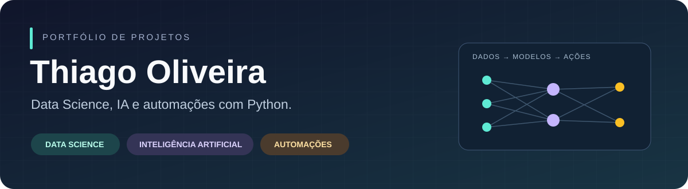

  

# Thiago Oliveira

**Data Science · Inteligência Artificial · Automações**

Desenvolvo análises, modelos preditivos, aplicações de IA e automações com Python. Meus projetos exploram comportamento de clientes, previsão de resultados, recomendação de produtos e rotinas de coleta e processamento de dados.

[LinkedIn](https://www.linkedin.com/in/thiago-ramos-oliveira/) · [Artigos no Medium](https://medium.com/@thiagoramos20042) · [Todos os projetos](PROJETOS.md)

## Três frentes de trabalho

| Foco | O que desenvolvo |
| --- | --- |
| **Data Science** | Análise exploratória, segmentação de clientes, classificação, regressão e simulações. |
| **Inteligência Artificial** | Recomendação por similaridade, processamento de texto e aplicações com modelos de linguagem. |
| **Automações** | Coleta por APIs e web scraping, processamento de dados e geração/envio de informações. |

## Projetos em destaque

<table>
  <tr>
    <td width="50%"></td>
    <td width="50%"></td>
  </tr>
  <tr>
    <td></td>
    <td></td>
  </tr>
  <tr>
    <td></td>
    <td></td>
  </tr>
</table>

## Explore cada frente

| Foco | Outros projetos para explorar |
| --- | --- |
| **Data Science** | [Atrasos no e-commerce](https://github.com/thiagoramos20042/e-commerce) · [Regressão em marketing](https://github.com/thiagoramos20042/marketing) · [Dados de treino](https://github.com/thiagoramos20042/api_strava) |
| **Inteligência Artificial** | [Sentimentos em avaliações de produtos](https://github.com/thiagoramos20042/nlp) · [Sales Insights API](https://github.com/thiagoramos20042/case) · [Recomendação de produtos](https://github.com/thiagoramos20042/sistema_recomendacao) |
| **Automações** | [Consulta CNPJ](https://github.com/thiagoramos20042/cnpj) · [Coleta de catálogo de moda](https://github.com/thiagoramos20042/webscrapping) · [Relatórios de cartão de crédito](https://github.com/thiagoramos20042/projeto3-Pi_datascience) |

Os [pipelines ETL e estudos de integração](PROJETOS.md#dados-e-integrações-de-apoio) complementam esses trabalhos com preparação e persistência dos dados.

## Tecnologias presentes nos projetos

- **Data Science:** Python, pandas, NumPy, Matplotlib, seaborn, Plotly e scikit-learn.
- **IA e machine learning:** LangChain, FAISS, TextBlob, PyCaret e algoritmos de classificação, regressão e recomendação.
- **Automações:** requests, Beautiful Soup, Selenium, APIs, SMTP e processamento de arquivos.
- **Aplicações e dados:** Streamlit, FastAPI, SQLAlchemy, SQL e SQLite.

## Sobre os trabalhos

Cada repositório apresenta o problema, a implementação e como explorar o código. O catálogo inclui aplicações, notebooks e projetos de formação, com o contexto de cada trabalho indicado na documentação.

## Contato

Vamos conversar sobre Data Science, IA aplicada e automações pelo [LinkedIn](https://www.linkedin.com/in/thiago-ramos-oliveira/). Compartilho estudos e experiências no [Medium](https://medium.com/@thiagoramos20042).
